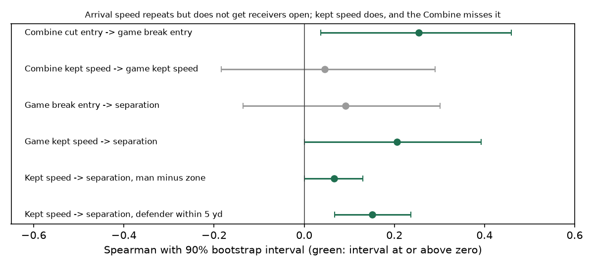

# The cut the Combine never sees

*NFL Big Data Bowl 2027, Open Track. Design Master Solutions LLC.
Notebook: `designmasterdms/does-the-combine-see-separation` (reproduces every number below).*

## The question

Receivers are drafted in part on what they do in shorts at the Combine. For the first time the 2027
data lets us watch those drills at 10 Hz, the same rate as the game tracking. So instead of asking
"does a fast 3-cone time predict a good receiver", we can ask a sharper question: **which movement,
measured frame by frame in a Combine drill, shows up again in how the same player moves and gets
open on NFL routes?**

Our answer, built in eight passes and summarized here, is a chain with one broken link:

1. How fast a receiver **arrives** at a cut repeats from the Combine to Sundays.
2. Arrival speed does not go with separation.
3. The speed a receiver **keeps through** the cut does go with separation, and most strongly
   against a man defender who is on him.
4. No Combine drill measures kept speed in a way that carries over, because no Combine cut has a
   defender.

## Data and target

- **Combine tracking** (10 Hz): 40-yard dash, 3-cone, short shuttle and the position route drills
  (slant, dagger, curl, comeback, slot strike) for wide receivers.
- **Game tracking 2023-25** (10 Hz) and `player_play.csv` (route, man/zone call, cushion at the snap,
  separation at the throw).
- **Target:** separation at the throw, adjusted for route type (a hitch and a go route open up very
  differently), as a per-player median. Players need at least 30 targets (Combine-only passes) or at
  least 15 break routes (game passes).
- **Statistic:** Spearman correlation with a 2,000-draw bootstrap 90% interval. In the route-level
  tests we resample players, not routes, because routes from one receiver are not independent.

## Step 1: the stopwatch and the naive tracking feature

A first pass took "speed kept through the break" straight from the Combine route drills and compared
it with game separation (93 WRs): **-0.07**. Peak speed in the same drills: -0.09. The timed 3-cone,
by contrast, went the expected way (faster time, more separation, **-0.43**, n=28). So the drills
carry some signal, but a naive tracking feature does not find it.

Splitting the 3-cone and shuttle turns into deceleration, plant and re-acceleration (546 turns,
42 players) did not beat the stopwatch either. What did work was **speed carried into a reversal**,
pooled over 3-cone and shuttle: **+0.30** (n=53, 90% CI +0.07 to +0.50), and a composite with how
well a player holds speed through the 3-cone bends reached **+0.32** (+0.09 to +0.52). On the 14
receivers with no recorded 3-cone time, reversal entry speed still pointed the same way (+0.50,
wide interval). Useful as a fill-in where the stopwatch is missing, but it did not yet say *why*.

## Step 2: what happens at the cut on the field

We built one break detector and used it everywhere. On a route with a break (out, in, corner, post,
slant, hitch), between the snap and the throw, the break is the frame where the heading turns
fastest over a 0.3 s window after the first 0.8 s. Two numbers per break:

- **entry speed**: peak speed in the second before the break;
- **kept speed**: slowest speed through the break divided by entry speed.

Both are route-adjusted and summarized as a per-player median. Over 3,514 break routes from 99 WRs
(median turn 81 degrees):

| in-game feature (60 WRs, >= 15 break routes) | Spearman vs separation | 90% CI |
|---|---|---|
| entry speed into the break | +0.09 | -0.14 to +0.30 |
| **speed kept through the break** | **+0.21** | +0.00 to +0.39 |

On Sundays it is the speed a receiver keeps through the cut, not the speed he brings into it, that
goes with getting open. And the Combine reversal entry speed from step 1 did not show up as in-game
entry speed for the 22 players we had in both sets (+0.03). The +0.32 of step 1 is not "fast into
the turn on Sundays".

## Step 3: the same detector on the Combine route drills

The closest Combine movement to a game cut is the route drill. We ran the identical detector on 321
drill cuts from 106 WRs (drill-adjusted), and matched 51 of them to their game breaks:

| Combine | game | Spearman | 90% CI |
|---|---|---|---|
| entry speed into the cut | entry speed into the break | **+0.25** | +0.04 to +0.46 |
| speed kept through the cut | speed kept through the break | +0.05 | -0.18 to +0.29 |
| speed kept through the cut | separation | +0.06 | -0.19 to +0.29 |
| entry speed into the cut | separation | +0.01 | -0.22 to +0.25 |
| (game) speed kept through the break | separation | +0.24 | +0.02 to +0.45 |

Measured movement to movement, the Combine carries over the part that does not matter: arrival
speed repeats, but arrival speed does not get receivers open. Kept speed is what gets receivers
open, and the Combine version of it does not repeat. A scripted, uncontested cut is not the cut a
receiver makes against a defender.

## Step 4: kept speed pays against man coverage

If kept speed matters because of the defender, it should matter more when a defender is trailing the
receiver. We joined the break routes to the defense's man/zone call and removed the cushion at the
snap from both kept speed and separation with a linear fit (2,421 routes, 95 WRs):

| coverage | routes | Spearman (kept speed vs separation) |
|---|---|---|
| man | 783 | +0.08 |
| zone | 1,638 | +0.02 |
| man minus zone | 2,421 | **+0.07** (90% CI +0.00 to +0.13) |

Against man it goes with separation four times as strongly as against zone; against zone, where the
defender waits in an area, it is close to nothing.

## Step 5: is it cause, or are those receivers just given room?

The tracking files carry only Combine participants, one to three players per play, so most of the
time the nearest tracked defender is not the man covering the receiver (median 12.2 yd away at the
break). We therefore kept only the **matchup routes**, where a tracked defender is within 5 yd at the
break: 188 routes, 64 WRs.

| matchup subset | x | y | n | Spearman | 90% CI |
|---|---|---|---|---|---|
| all | kept speed | separation | 188 | **+0.15** | +0.07 to +0.24 |
| all | kept speed | separation, defender distance held fixed | 188 | +0.15 | +0.06 to +0.24 |
| all | kept speed | defender distance at the break | 188 | +0.07 | -0.04 to +0.18 |
| defender trailing the cut | kept speed | separation | 72 | +0.16 | +0.01 to +0.28 |

With a defender really on him, a receiver's kept speed goes with separation twice as strongly as in
man overall, and holding the defender's distance at the break fixed does not change it. Receivers
who keep speed are not simply the ones defenders give room to (+0.07, interval crosses zero). It is
strongest when the defender trails the cut, which is exactly the situation the Combine never creates.

## What a team can do with this

- **Read the route drill for arrival speed, not for the cut.** Combine entry speed into a cut is a
  real, repeatable trait (+0.25 into games), but by itself it does not buy separation.
- **Do not read "smooth through the cut in shorts" as a separation skill.** It does not repeat
  (+0.05). The skill that gets receivers open is contested.
- **Measure kept speed where it exists: on game film against man.** For college prospects that means
  charting man-coverage breaks, or adding a contested drill (a trailing defender or a reactive cue)
  to private workouts. The tracking already shows how to score it: slowest speed through the
  break over entry speed, route-adjusted.
- **Keep the stopwatch.** The timed 3-cone is still the single best Combine number where it exists;
  the reversal-entry composite fills in for the players who skip it.

## Limits

- Samples are small where both data sets meet (22 to 64 players), so these are directions, not a
  ranking tool; every key number carries its interval.
- Tracking covers only Combine participants, so the defender tests rely on the 188 routes where a
  tracked defender is close. Separation at the throw comes from all 22 players, so the "defender
  distance held fixed" check mixes the tracked defender with the nearest one at the throw.
- Correlations, not experiments. Step 5 rules out the most obvious confounder (room given at the
  break) but not every one (route concepts, quarterback timing).

## Reproduce

Everything above runs from `analysis/01`-`08` in the public repository
(github.com/DesignMaster-Solutions/combine-separation, MIT) and in the attached Kaggle notebook,
which prints each table on the competition data. Competition data is not redistributed.
